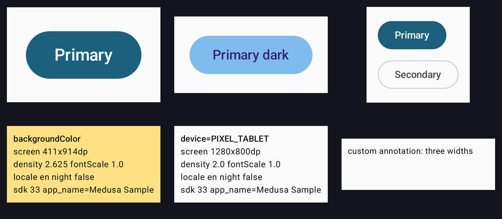
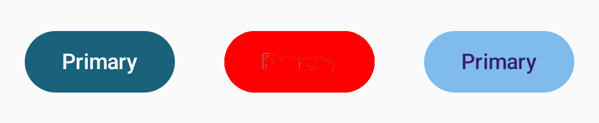

<h1 align="center">🐍 Medusa</h1>

<p align="center"><b>Your <code>@Preview</code>s are already your tests. Medusa just checks them.</b></p>

<p align="center"><i>One look and your screens are turned to stone. Change a pixel and she'll notice.</i></p>

<p align="center">
  <a href="https://central.sonatype.com/artifact/io.github.araujojordan/medusa-gradle-plugin"></a>
  <a href="https://github.com/AraujoJordan/medusa/actions/workflows/ci.yml"></a>
  <a href="https://jitpack.io/#AraujoJordan/medusa"></a>
  <a href="LICENSE"></a>
  
</p>

<p align="center"></p>

Screenshot tests for Jetpack Compose, rendered by Google's [Android CLI](https://developer.android.com/tools/agents/android-cli/overview)
(`android preview render`). No device, no emulator, no Android Studio, and **no test code**: every `@Preview` you already wrote is a test.
Golden images live **right next to the Kotlin file** that declares the preview.

## 🤔 But why??

Because you already wrote the preview. Paparazzi and Roborazzi want a test class per screen. Google's own tool wants your previews in a
second source set. Shot and Dropshots want an emulator in CI. Medusa asks the Android CLI which `@Preview`s exist, renders them, and
compares the pictures with last time's. That's it. That's the library.

**Why "Medusa"?** In the myth, one look from Medusa turns you to stone. This plugin gives your `@Preview`s that same look:
`medusaRecord` petrifies every screen as a golden image, and `medusaVerify` checks that nothing has moved since. Unlike the myth,
`medusaRecord` undoes it.

## ⚡ 30 seconds

```kotlin
// settings.gradle.kts
pluginManagement {
  repositories { google(); mavenCentral(); gradlePluginPortal() }
}

// build.gradle.kts of a module with previews
plugins {
  id("com.android.library") // or com.android.application
  id("io.github.araujojordan.medusa") version "0.2.0"
}
```

```bash
./gradlew medusaSetup    # once: installs the Android CLI and odiff for you (no sudo)
./gradlew medusaRecord   # render every @Preview, save the goldens
./gradlew medusaVerify   # render again and compare (also runs as part of `check`)
```

```
ui/components/
  Button.kt
  Button_PrimaryButtonPreview.png            # one @Preview
  Button_PrimaryButtonLabelsPreview_0.png    # @PreviewParameter, @PreviewLightDark, ...: one image per value
  Button_PrimaryButtonLabelsPreview_1.png
```

<details>
<summary>Using JitPack instead of Maven Central</summary>

Every tag is also built by JitPack, with the tag as the version and the group `com.github.AraujoJordan.medusa`:

```kotlin
// settings.gradle.kts
pluginManagement {
  repositories { maven("https://jitpack.io"); google(); mavenCentral(); gradlePluginPortal() }
  resolutionStrategy {
    eachPlugin {
      if (requested.id.id == "io.github.araujojordan.medusa") {
        useModule("com.github.AraujoJordan.medusa:medusa-gradle-plugin:${requested.version}")
      }
    }
  }
}
// build.gradle.kts: id("io.github.araujojordan.medusa") version "v0.2.0"
```

JitPack also needs `maven("https://jitpack.io")` in `dependencyResolutionManagement { repositories { ... } }`, because the plugin depends on `medusa-core`.
</details>

Everything else (tasks, `--preview` filters, the `medusa { }` block) is in [docs/setup.md](docs/setup.md).

## 🖼️ What a failure looks like

<p align="center"></p>

Left to right: expected, diff, actual (Paparazzi's own failure image format). Here a dark theme sneaked into a button:

```
odiff: 24343 of 71190 pixels differ (34.194%, allowed 0.010%)
```

The images land in `build/medusa/failures/`, with an HTML report in `build/medusa/report/` and JUnit XML for CI.

## ✨ Features

- **Zero test code.** Multipreviews, `@PreviewLightDark`, `@PreviewParameter` and your own custom preview annotations all work ([how](docs/how-it-works.md)).
- **Fast pipeline.** Rendering and comparison overlap: finished images are compared while the CLI is still rendering ([numbers](docs/benchmarks.md)).
- **Pick your comparer.** odiff by default (installed and checksum-verified for you), or Paparazzi's own differs, an in-process port, or ImageMagick ([differs](docs/differs.md)).
- **Multi-module.** Root commands and `check` automatically batch compatible modules through their unique app; goldens and reports stay with their source module ([multi-module](docs/multi-module.md)).
- **Accessibility snapshots** as an opt-in text file next to each golden.
- **Honest about its limits**: [what works and what was verified where](docs/limitations.md).

## ⚖️ Medusa vs the rest

| Library | Single record | Single verify | Multi record | Multi verify |
|---|---:|---:|---:|---:|
| **Medusa** | 6.5 s | 12.5 s | 6.2 s | 6.9 s |
| [Paparazzi](https://github.com/cashapp/paparazzi) | 7.6 s | 8.3 s | 10.3 s | 10.3 s |
| [Roborazzi](https://github.com/takahirom/roborazzi) | 9.2 s | 9.5 s | 14.1 s | 14.5 s |
| [Google Compose Screenshot Testing](https://developer.android.com/studio/preview/compose-screenshot-testing-with-testsuites) | 6.7 s | 6.6 s | 10.5 s | 10.6 s |
| [Shot](https://github.com/pedrovgs/Shot) | 41.1 s | 41.1 s | 76.9 s | 78.1 s |
| [Dropshots](https://github.com/dropbox/dropshots) | 41.6 s | 40.9 s | 75.3 s | 75.4 s |

50 screenshots in each project: **single** is one app; **multi** is an app plus four libraries with 10 screenshots each. Wall-clock medians of three runs on M1 Max / JDK 21, after an untimed warm-up. Record includes editing one composable; verify forces fresh rendering. Build/configuration caches are off. Host tools use three parallel Gradle workers; Shot and Dropshots use one already-booted API 35 emulator, including installation and image transfer.

All fixtures passed a deliberate-mismatch control. Renderers and default tolerances differ; these results compare full workflows, not equivalent pixels or maximum throughput. [Versions, setup and methodology](benchmark/libraries/README.md) · [Ranges](benchmark/libraries/RESULTS.md) · [Raw runs](benchmark/libraries/results.json).

### Upgrading to 0.2.0

The renderer daemon and automatic app-host aggregation are enabled by default. App resource overrides or
dependency resolution can change library preview pixels. Review changes before re-recording; use
`medusa { autoAggregate = false }` to preserve standalone module rendering. Qualified module Medusa tasks
remain standalone. Details: [multi-module behavior](docs/multi-module.md).

## 🏎️ Performance

The comparison above measures released Medusa 0.2.0 and all five alternatives on the same generated UI workload.
Medusa's automatic aggregation batches the multi-module previews while preserving module-owned goldens and reports.
See [the full benchmark](benchmark/libraries/RESULTS.md) and [performance details](docs/benchmarks.md).

## 🔁 Coming from Paparazzi

| Paparazzi | Medusa |
|---|---|
| `recordPaparazziDebug` | `medusaRecord` |
| `verifyPaparazziDebug` | `medusaVerify` |
| `cleanRecordPaparazziDebug` | `medusaCleanRecord` |
| `deletePaparazziSnapshots` | `medusaDelete` |

- The pixels will not match Paparazzi's (a different renderer), so record fresh goldens.
- Want Paparazzi's exact verdicts? `medusa { differ = "offbytwo" }` uses its code; the 0.01% tolerance is already the default.
- Goldens are PNGs next to your sources, so if you use Git LFS: `echo '*.png filter=lfs diff=lfs merge=lfs -text' >> .gitattributes`.

## 📋 Requirements and status

- JDK 17+, Gradle 9.1+, Android Gradle Plugin 9.x, and the Android CLI (`medusaSetup` installs it).
- **Version 0.2.0.** Compose `@Preview`s only, debug variant only, no animations.
- Verified on macOS arm64, and in CI (unit and Gradle TestKit tests) on Ubuntu and macOS. Rendering on Linux was checked in an amd64
  container under emulation. **Windows is untested**, and one Linux question (`android-37`) is still open. Full list: [docs/limitations.md](docs/limitations.md).

## 🧪 In CI

Not yet verified on GitHub-hosted runners, so treat this as a starting point:

```yaml
- uses: actions/cache@v4
  with: { path: ~/.medusa, key: medusa-${{ runner.os }} }
- run: ./gradlew medusaSetup medusaVerify
```

## ❓ FAQ

**Do I write tests?** No. That's the point.

**Why does a golden end in `_0`?** The preview expands to several images (`@PreviewParameter`, `@PreviewLightDark`, ...), numbered in declaration order.

**Why did verify fail on a size change?** Images are cropped to their content, so a layout change is a size change, and a size change always fails.

**Where did odiff come from?** `medusaSetup` (or the first verify) downloads a pinned release and checks its SHA-256. Offline, Medusa warns and uses the built-in `yiq` differ.

**Is Paparazzi dead?** No, and "which one wins" is the wrong question: they can live in the same project. See [docs/comparison.md](docs/comparison.md).

## 🤝 Contributing

Issues and PRs welcome, see [CONTRIBUTING.md](CONTRIBUTING.md). Found something in the comparison that is out of date or unfair? Please say so.

## 🙏 Credits

- [Paparazzi](https://github.com/cashapp/paparazzi) by Cash App: its six image differs are vendored unchanged (Apache-2.0, see [NOTICE](NOTICE)).
- [odiff](https://github.com/dmtrKovalenko/odiff): the default comparer.
- The [Android CLI](https://developer.android.com/tools/agents/android-cli/overview), which does the rendering.

## 📜 License

Apache-2.0 © 2026 Jordan L. Araujo Jr. Go build something. Verify responsibly.

[](https://star-history.com/#AraujoJordan/medusa&Date)
